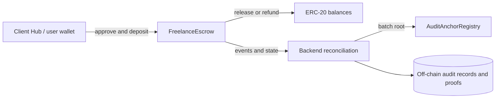

# Client Hub — Smart Contracts

Optional blockchain components for [Client Hub](https://github.com/Triet1705/client-hub-backend): whole-invoice escrow, audit-root anchoring, and a work-certificate prototype.

Built with **Solidity 0.8.28, Hardhat 3, OpenZeppelin, ethers, and TypeScript**. The conventional project/task/FIAT workflow runs without these contracts.

## Contracts

| Contract | Purpose | Boundary |
| --- | --- | --- |
| [`FreelanceEscrow`](contracts/FreelanceEscrow.sol) | Accept whitelisted ERC-20 deposits, release/refund invoice amounts, and support owner dispute resolution | One escrow per invoice; no milestone payments |
| [`AuditAnchorRegistry`](contracts/AuditAnchorRegistry.sol) | Record an owner-submitted Merkle root, record count, and metadata hash | A commitment to off-chain records, not the records themselves |
| [`WorkCertificate`](contracts/WorkCertificate.sol) | Non-transferable ERC-721 certificate with EIP-5192 locking and owner mint/burn | Contract exists; backend mint integration remains simulated |
| [`MockERC20`](contracts/test/MockERC20.sol) | Mintable, 18-decimal mUSDT for local development | Test asset with no real monetary value |

The escrow uses `SafeERC20`, reentrancy guards, and pause controls. The registry supports pause controls and rejects duplicate/invalid roots. These mechanisms do not constitute an independent security audit.

## How it fits together



Users sign their own escrow transactions. Backend reconciliation checks the invoice participants, token, amount, and confirmation state before updating application records. The application uses integer token base units; local mUSDT has **18 decimals**, which must match both frontend and backend configuration.

The backend constructs audit leaves and proofs off-chain. Anchoring a root establishes a commitment that can be checked later; it does not establish the truth of the original business event. Raw audit records and tenant identifiers are not written to the registry.

## Install and verify

Use a current **Node.js 22 LTS** version compatible with the locked Hardhat dependency and npm. CI uses Node 22.

```powershell
npm ci
npx hardhat compile
npm run test:ci
```

`npm test` runs the Hardhat suite directly. `npm run test:ci` additionally guards against a run collecting zero tests. Tests live under [`test/`](test/) and cover escrow, audit registry, and certificates. No test count is treated as a permanent guarantee; inspect the actual run output.

## Local Web3 workflow

For the integrated workflow, keep the three repositories as siblings:

```text
client-hub-project/
  client-hub-backend/
  client-hub-frontend/
  client-hub-contracts/
```

From this repository, start one disposable local chain:

```powershell
npx hardhat node --hostname 127.0.0.1 --port 8545
```

Keep that terminal open. In a second terminal, from the same repository:

```powershell
npm run local:bootstrap
```

This is a **state-changing development command**. It deploys the three application contracts and MockERC20, whitelists the token, mints demo balances, and writes `deployments/localhost-31337.json` plus `deployed_address.txt`. The chained synchronization script updates known keys in sibling backend `.env` and frontend `.env.local` files. The local synchronization implementation can also update an existing matching IntelliJ run configuration; review the script before using it with an established workspace.

For contract deployment without sibling environment synchronization, use `npm run bootstrap:local`. To synchronize an existing manifest later, use `npm run sync:local-env`.

### Before an escrow demo

1. Confirm manifest chain ID **31337**, and use its current escrow, token, and audit registry addresses.
2. Pass those addresses to the actual backend process, with `BLOCKCHAIN_ENABLED=true`. Local tests may use `BLOCKCHAIN_REQUIRED_CONFIRMATIONS=1`; the application default is 12.
3. Use `ESCROW_TOKEN_DECIMALS=18` for local mUSDT and the matching frontend value.
4. Restart backend/frontend. Spring Boot does not automatically load an arbitrary `.env`; the Java launcher must receive its variables.
5. Connect the wallet to `http://127.0.0.1:8545` and explicitly bind the intended account to its Client Hub profile.
6. Use fresh disposable crypto invoices for this chain instance.

The local chain is in memory. Restarting it removes contracts, balances, approvals, and transaction history while PostgreSQL can retain old invoice records. Bootstrap again after a reset; old database transactions cannot be recovered from a new chain. Never reuse deterministic Hardhat keys for real funds.

The manifest-driven bootstrap is the integrated local setup path. The old split `deploy.ts` / `setup-dev.ts` sequence is not a replacement for it.

## Payment and proof interpretation

- Verify ERC-20 settlement with token balance deltas, receipt status, and `Transfer` events. A native-ETH transfer display of zero is not evidence that an ERC-20 payment failed.
- Keep payment transactions separate from audit-anchor transactions in the UI and reports.
- A wallet being connected does not establish profile ownership or permission to act on an invoice.
- Owner-controlled token whitelisting, dispute resolution, anchoring, and certificate issuance remain centralized administrative powers.

## Network and release scope

[`hardhat.config.ts`](hardhat.config.ts) includes local simulation and Polygon Amoy configuration using `AMOY_RPC_URL` and `ADMIN_WALLET_KEY`. A configured network is not evidence of deployment or acceptance on that network.

The retained hosted Client Hub evaluation disabled blockchain and audit anchoring. Local contract tests and integration evidence do not establish mainnet safety, real-money readiness, or completion of the Amoy acceptance gate.

Milestone escrow and fully integrated on-chain certificate minting are outside the delivered application scope. Secrets, local deployment manifests, and filled environment files must remain outside commits unless a deliberate public artifact policy says otherwise.

[Backend integration](https://github.com/Triet1705/client-hub-backend) · [Web application](https://github.com/Triet1705/client-hub-frontend)
